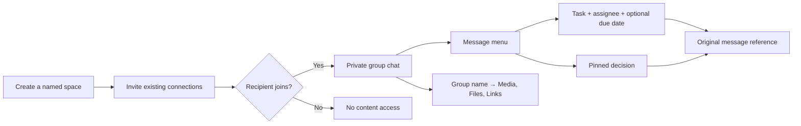

# Conversation Spaces

Spaces bring group chat, decisions, tasks, and resources together around a named plan. The same people can have separate spaces for a trip and a project. Each has independent membership and history; joining never creates direct chats between participants.

## Everyday workflows

- **Create/join:** choose **Spaces → New**, enter a name and optional purpose, and select connections. The creator becomes owner; invitees choose **Join space** or **Decline** before gaining content access.
- **Chat:** send text, emoji, GIFs, or attachments; load **Earlier messages** for history. The message menu offers **Create task**, **Pin as a decision**, and **Save to links** for URLs.
- **Tasks:** create from a message or the Tasks tab, assign a joined member or **Anyone**, and optionally set a due date. Filter **Assigned to me**, complete/reopen tasks, or follow **View message** to the source.
- **Decisions:** pin agreements from messages or the Decisions tab. Deleting tasks or unpinning decisions preserves source messages.
- **Space info:** open the conversation header for purpose, members, invitations, and **Media, files and links**. Plain-text HTTP/HTTPS links are collected automatically and can receive custom labels. Owners and admins can invite more connections here. Any joined admin can choose a joined member’s menu → **Make group admin**; the owner stays protected.

## Membership and permissions

Creating or joining requires a confirmed email, valid display name, and valid private phone number. Admins can invite their own accepted direct connections; invitations still require acceptance. Member payloads expose display names and membership information; email addresses and phone numbers stay private.

| Actor | Allowed actions |
| --- | --- |
| Joined member | Read and chat; create unassigned checklist items, decisions, and links; complete shared checklist items or tasks assigned to them. |
| Task creator or group admin, while joined | Edit or delete a task. Only admins may assign, reassign, or unassign; a creator may edit title/date while preserving an existing assignment. |
| Decision creator or owner, while joined | Unpin the decision. |
| Group admin | Invite connections, promote/demote non-owner members, remove other non-owner members, assign tasks, and complete/reopen assigned tasks. |
| Owner | Protected primary admin; cannot be demoted or removed. |
| Pending invitee | Read their invitation summary and accept or decline; cannot read messages, tasks, decisions, links, or files. |
| Anonymous user, outsider, or departed member | No space content access. |

A space allows **20 people including the owner and pending invitations**. Displayed member counts include joined members only. Each owner can create **10 spaces per rolling hour**. Duplicate invite selections do not consume extra places.

Nonowners can leave from Space info. Leaving revokes subsequent table, RPC, and Storage access and unassigns their **open** tasks in that space; completed tasks and existing messages remain. Declined and departed members cannot currently be invited again. The owner cannot leave because ownership transfer is not supported.

## System and data model

The Next.js client uses Supabase Auth, PostgreSQL RPCs, and private Storage. SQL derives identity from `auth.uid()`. Tables allow SELECT under RLS; mutation RPCs enforce permissions and serialize membership checks with a space lock. Definer functions use an explicit empty search path.

| Table | Purpose |
| --- | --- |
| `spaces` | Title, purpose, owner, creation time. |
| `space_members` | One row per space/user; owner/admin/member role; invited/joined/declined/left status; inviter and join/read timestamps. |
| `space_messages` | Sender, body, timestamp, attachment metadata; trusted system activity has `kind=system` and typed `system_event` metadata. |
| `space_tasks` | Title, optional assignee/due date/source message, creator and completion attribution. |
| `space_decisions` | Agreement, creator, optional source message. |
| `space_links` | URL, label, creator, optional source message. |
| `space_task_notifications` | Recipient-only assignment inbox with task, actor, source activity message, creation/read timestamps. |

Sources must belong to the same space. Tasks and decisions each deduplicate by space/source message; retries return the original item. Links deduplicate by space/URL. Existing `basic_profiles` and `basic_chats` supply identities and connections.

### History and live updates

`list_space_messages` and `list_space_resources` order pages by **`created_at DESC, id DESC`**. The UI requests 50 rows; SQL permits 1–100. Pass both `p_before` and `p_before_id` from the oldest row to handle timestamp ties correctly. The client deduplicates by ID and displays chat chronologically. Media/files paginate separately; tasks, decisions, and links use the `get_space` snapshot. Source-message dialogs read by ID under RLS, beyond loaded history.

Realtime refreshes the list and conversation, with visible-page polling fallback (10 seconds/8 seconds respectively) and focus refresh. Unread counts exclude own messages. Entering Chat refreshes messages first, then acknowledges only the latest fetched message using a monotonic `(created_at,id)` read cursor; a message arriving during that request remains unread. After a long suspension, disconnected history windows reset to a continuous latest page with earlier history still accessible.

### Activity and assignment alerts

Database triggers add durable, plain system text for group creation, invitations, joins, departures/removals, admin changes, task creation/assignment/reassignment/updates/completion/deletion, and pinned/unpinned decisions. They share the chat's pagination and are rendered without user bubbles or message menus. Users cannot insert system events directly; no-op retries do not create duplicate events.

Only the current assignee receives a personal assignment notice and Tasks badge. A global recipient-filtered subscription and eight-second fallback work across app navigation. Opening Tasks acknowledges only fetched notification IDs; chatting does not clear task alerts. Reassignment, completion, deletion, removal, or leaving invalidates stale notices. To avoid double sounds, system activity does not trigger generic group-message sounds.

The existing Vault secret queues an ID-only webhook to `/api/push/task-assignment`. That route authenticates the webhook and reloads the notification, current task assignment, and joined recipient before selecting only that recipient's device subscriptions. Push text contains no names, task titles, or group content. Clicking it opens the Tasks view at the assigned task. Requires the updated frontend/API deployment and normal notification opt-in. Ordinary group-message Web Push remains unavailable.

Success toasts automatically clear after five seconds, assignment toasts after six, and transient action errors after eight. Identical repeated notices restart the timer; replacing a notice cancels the previous timer. Load/retry states and essential field guidance remain visible as page content.



## Typing indicators

Space chats and direct messages show named typing activity above the composer, including multiple people. Names come from the authorized member list, never from an activity payload. The fixed-height status area avoids moving the conversation as activity appears. Dots respect reduced-motion preferences and the text is announced politely to screen readers.

Apply `023_conversation_typing.sql` after the existing migrations. `conversation_typing` stores only conversation IDs, the authenticated user ID, a per-view session UUID and a six-second expiry. It contains no draft text, names or notification data. Clients have SELECT-only grants and member-scoped RLS. `set_conversation_typing` derives identity from `auth.uid()` and validates membership on every update; `list_conversation_typing` filters expired activity, the viewer’s own activity and departed space members. Remaining lifetime is calculated on the server so browser clock differences cannot leave an indicator stuck.

The composer starts activity on nonblank text or emoji edits, renews at most once every two seconds, and stops after three seconds without edits. Clearing, sending, input blur, page hiding, navigation and switching away from Chat also stop it. Requests are serialized so a slow start cannot arrive after its stop. Different browser tabs/devices have separate sessions, combined into one name, so one device’s stop does not clear another device’s activity.

Supabase Postgres Changes refreshes the typing snapshot on INSERT/UPDATE; membership RLS controls delivery. A three-second visible-page polling fallback covers missed events or unavailable Realtime. Local timers remove expired names even if requests fail. Crashed/disconnected sessions expire within six seconds of the last successful update; later activity prunes records that expired more than a minute ago. This adds small database writes during typing and two-party/group reads while a conversation is visible; it does not create chat messages, sounds, unread counts or push alerts.

## Private attachments

The private `space-files` bucket allows files up to **20 MiB**: JPEG/PNG/WebP/GIF, MP4/WebM, MP3/OGG, PDF, plain text, Office documents, and ZIP. Paths are `<space-id>/<uploader-id>/<random-uuid>`; message metadata retains the filename.

Upload first, then call `send_space_message` with `{ path, name, mime, size }`. SQL checks joined membership, uploader path, metadata, and matching trusted Storage MIME/size. Published objects cannot be reused, overwritten, or deleted; the object foreign key protects against concurrent deletion. Uploaders can clean up their unpublished files after failed sends. Restrictive Storage policies prevent unrelated permissive policies from widening access.

Previews/downloads use **authenticated `storage.download()`**, checking membership through Storage RLS on each fetch. Local Blob URLs support lazy image previews and audio/video on demand; documents download. URLs are revoked after use/unmount. The frontend uses no signed attachment URLs. Leaving blocks future fetches but cannot retract downloaded bytes.

## Deployment and verification

### Polls before decisions

Inside **Decisions**, a small switch separates **Pinned decisions** from **Polls** without adding a main navigation tab. Anyone who has joined can create a question (240 characters) with 2–8 distinct choices (120 characters each). Questions and choices are immutable after publication. Each member can cast, change, or withdraw one vote until closure. The creator or a joined admin can close voting; closure is irreversible. The group can leave the result as a poll indefinitely.

After closure, the creator or an admin may pin a most-voted option as a decision. A tied result requires explicitly choosing one of the tied options after discussion; it is labeled as chosen after a tie. No-vote polls cannot become poll decisions; direct decisions remain available. The resulting decision keeps the question, selected option, and a server-generated snapshot of final counts, with **View poll & results** opening its source. One decision per poll prevents duplicate pins; unpinning leaves the poll and results intact. Message-to-decision and direct pinning do not require voting.

Migration **022_space_polls.sql** adds `space_polls`, immutable `space_poll_options`, and one `space_poll_votes` row per poll/voter. Same-space composite foreign keys prevent mixing choices or decision sources across polls/groups. Joined members can SELECT poll metadata/options; vote-table RLS exposes only their own ballot. Security-definer read RPCs expose aggregate totals without voter identities or private contact fields. Mutations derive the voter from `auth.uid()`, deny direct table writes, and serialize with membership changes and closure using the existing space lock. Cast votes remain in results when a member leaves, but that person immediately loses further poll access. Final decision snapshots omit the caller's personal vote field.

Poll creation uses a stable client request UUID with server-side payload checks for safe retries and a quota of 20 polls per creator per rolling hour. Create/close activity appears as ordinary muted system text in Chat; individual votes do not generate chat noise. Poll metadata revisions notify Realtime subscribers without exposing ballots, backed by visible-page refresh every eight seconds. Polls use timestamp/UUID keyset pages of 20; source dialogs can retrieve older polls directly.

Apply **022 after 021** before deploying the updated frontend. The isolated preview fixture includes both migrations. Run `node --test tests/space-polls-db.test.mjs` for voting, privacy, permissions, closure, ties, idempotency, provenance, pagination, and regression checks for direct/message decisions.

Apply migration `020` after `019`, then `021_space_admins_activity_notifications.sql`, before deploying the frontend. Migration 021 preserves existing memberships/tasks and adds admin permissions, activity triggers, a recipient-only notification table, and task Web Push enqueue. It uses existing Auth, Storage, Vault, and push configuration; unavailable push infrastructure never prevents a task from saving. Polling supports operation without Realtime. Migration 020 must not be edited or reapplied to upgrade an existing project.

Run the SQL security suite with:

```sh
node --test tests/spaces-db.test.mjs
```

Tests execute real PostgreSQL in PGlite with Auth/Storage schema bootstraps. Coverage includes consent/profile prerequisites, limits, actor/space isolation, grants/RLS, task/decision permissions, source deduplication, URL validation, unread state, leave revocation, attachment validation/immutability, restrictive Storage policies, and timestamp-tie pagination. Hosted Storage HTTP and browser rendering need separate checks.

Manual fixture: `node tests/fixtures/spaces-ui-server.mjs` serves the Next frontend with local SQL, synthetic accounts, and in-memory uploads on loopback ports 5174/5181 (`SPACES_WEB_PORT`/`SPACES_API_PORT` overrides). The logged `fixtureRoot` accepts frontend updates. Login: Alice/Bob at `alice@example.test`/`bob@example.test`, password `preview-pass`. Check joining, source dialogs, task edits, private upload/download, and leaving; verify deployed Storage and Realtime separately.
